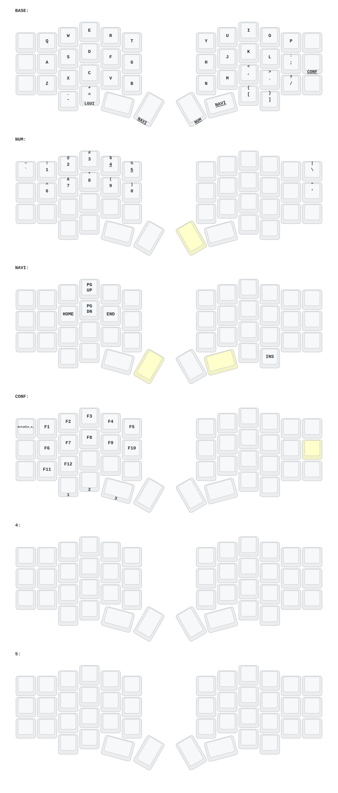

# Noirix44 — DYA Studio 固件

这是为 Noirix44 分体键盘维护的 ZMK 固件仓库。

本项目在原有 Noirix44 键位配置上增加 DYA Studio 及运行时配置功能，
参考 [zmk-sofle-dongle-dya](https://github.com/S7venYoung/zmk-sofle-dongle-dya) 实现。

## 分支说明

| 分支 | 用途 | 状态 |
| --- | --- | --- |
| `dya` | 基于 `main+dya` 与 Zephyr 4.1 的新版适配，DYA Studio 功能 | 当前版本 |
| `st7789v` | 在 `dya` 基础上增加 ST7789V 状态监视器（Monitor），含状态广播 | 参考分支 |

日常使用请选择 `dya` 分支。

## DYA Studio 功能

- DYA Studio 改键（左半通过 USB 串口）
- Runtime Macro（运行时宏）
- Runtime Combo（运行时组合键）
- Runtime Sensor Rotate（运行时传感器/编码器配置）
- Runtime Input Processor（运行时输入处理器）
- BLE 管理（DYA Studio 查看/管理蓝牙连接）
- Settings RPC（DYA Studio 在线修改并保存设置）
- Device Info（固件、硬件和运行状态诊断）
- Custom Settings（DYA Studio 在线修改并保存自定义设置）

> 本分支**不包含**蓝牙状态广播与独立监视器（Monitor）功能。

## DYA Studio 使用

本固件的大部分功能（改键、Runtime Macro、Runtime Combo、BLE 管理、Settings、Device Info）都通过 DYA Studio 操作，使用前请先用 USB 连接键盘左半（central），再打开工具：

- **网页版（免安装，推荐）：** https://studio.dya.cormoran.works/
- **桌面客户端下载：** https://github.com/cormoran/dya-studio/releases

浏览器使用网页版时，若提示串口被占用，请关闭其他 DYA Studio 页面或占用串口的软件。

### 技术栈

- ZMK：`cormoran/zmk#main+dya`
- Zephyr：`v4.1.0+zmk-fixes+nrf-half-duplex-uart`
- DYA Studio Custom Protocol
- `zmk-feature-custom-settings`
- `zmk-feature-device-info`
- `zmk-feature-runtime-macro`
- `zmk-feature-runtime-combo`
- `zmk-behavior-runtime-sensor-rotate`
- `zmk-module-ble-management`
- `zmk-module-battery-history`
- `zmk-module-settings-rpc`
- `zmk-module-runtime-input-processor`

## 固件文件

GitHub Actions 构建完成后，在运行记录的 Artifacts 中下载固件压缩包。

| 固件 | 刷写位置 | 主控 |
| --- | --- | --- |
| `noirix44_left.uf2` | 键盘左半（central） | nRFMicro (nRF52840) |
| `noirix44_right.uf2` | 键盘右半（peripheral） | nRFMicro (nRF52840) |
| `noirix44_settings_reset.uf2` | 清除键盘配对与设置 | nRFMicro (nRF52840) |

> 键盘左右半、settings_reset 分别使用不同固件，请按上表对应刷写，不要混刷。

## Runtime Macro

本分支已启用 Runtime Macro，现有 keymap 中的静态按键绑定保持不变，两者互不冲突。

keymap 第 3 层（layer_3）第一行最右侧按键已预绑定为：

```dts
&rmacro 0
```

使用方法：

1. 用 USB 连接键盘左半。
2. 打开 DYA Studio。
3. 进入 Macro 页面。
4. 创建 Macro 并确认其 Slot 编号。
5. Slot 0 对应当前预留的 `&rmacro 0` 按键。
6. 点击保存后，Macro 会写入键盘设置。

刚刷入固件、尚未创建 Slot 0 时，按下该键不会执行任何内容。

## Runtime Combo

本分支已启用 Runtime Combo，可以通过 DYA Studio 在运行时创建和修改组合键。

它与 Runtime Macro 可以共存：Combo 负责监听多个按键位置，Macro 负责执行一串行为。

使用方法：

1. 用 USB 连接键盘左半并打开 DYA Studio。
2. 进入 Runtime Combo 子系统页面。
3. 选择空 Slot，设置名称、按键位置、输出行为、适用层和超时时间。
4. 保存并测试；需要断电保存时启用持久化选项。

固件只预留运行时 Combo 槽位，没有增加默认 Combo，因此首次刷写不会改变现有按键行为。

## Device Info

键盘左半固件启用 Device Info。通过 USB 连接左半并打开 DYA Studio 的 Troubleshooting 页面后，可以查看：

- ZMK、Zephyr、配置仓库及模块的版本信息
- 编译时间、板型和固件 Build ID
- MCU、Flash、SRAM 和上次复位原因
- USB、BLE、分体、显示等编译配置
- 运行时间和 Zephyr 设备初始化状态

设备信息默认遵循 Studio 的安全访问设置。

## 编译

仓库使用 GitHub Actions 自动构建：

1. 切换到 `dya` 分支。
2. 打开 Actions。
3. 运行 Build workflow，或向该分支提交一次改动。
4. 等待全部 Build Job 完成。
5. 下载 Artifacts。

## 已知问题与使用建议

### 右手（peripheral）单独断电重开无法自动重连

**现象**：只关闭右手键盘的电源再重新打开，右手有时无法自动与左手（central）重连；把左手也关闭再打开（或左右手同时重启）后即可恢复连接。

**原因**：这是 ZMK 分体 BLE 的已知时序问题。右手断电属于"非优雅断开"，左手需要等待 supervision timeout（默认约 4 秒）才感知断开并重新扫描；而右手重新上电后先进入短暂的直连广播窗口，随后转为低速广播（约 1.28 秒一次、窗口极小）。当左手的重扫窗口与右手的低速广播错开时，就会持续错过，直到左手重启、BLE 栈整体复位后才重新对齐。

**使用建议**：

- 日常使用中，右手中途断电重开时，先等待 **5~10 秒**，一般可自动连回；
- 若超过 10 秒仍未连回，将左右手同时关闭再打开即可恢复；
- 这是 ZMK 生态的普遍现象，不是硬件故障，不影响正常使用；
- 当前版本**不做代码层面修复**，保持 ZMK 原生重连行为。

## 注意事项

- 修改 DYA 运行时设置前，确保连接的是键盘左半串口。
- 浏览器提示串口已打开时，关闭其他 DYA Studio 页面或占用串口的软件。
- 刷写新版底层后出现连接问题时，优先执行一次完整的 Settings Reset 和重新配对。

## 键位图



## 参考项目

- [zmk-sofle-dongle-dya](https://github.com/S7venYoung/zmk-sofle-dongle-dya)
- [DYA Studio Developer Guide](https://studio.dya.cormoran.works/developer-guide)
- [cormoran/zmk-feature-runtime-macro](https://github.com/cormoran/zmk-feature-runtime-macro)
- [cormoran/zmk-feature-custom-settings](https://github.com/cormoran/zmk-feature-custom-settings)
